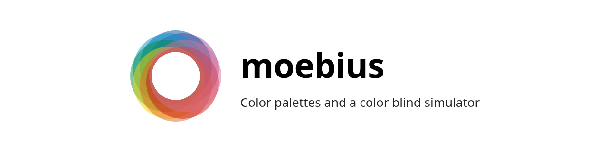

<picture>
  <source media="(prefers-color-scheme: dark)" srcset="https://raw.githubusercontent.com/phun-ky/site-moebius/main/docs/img/banner-dark.png">
  
</picture>

[](https://github.com/phun-ky/site-moebius/actions/workflows/check.yml)
[](https://scorecard.dev/viewer/?uri=github.com/phun-ky/site-moebius)
[](LICENSE)

**[moebius.wtf](https://moebius.wtf)** makes color palettes from two colors you
pick, shows how they look to people with color blindness, and gives you the code
to use them.

- [What it does](#what-it-does)
- [Development](#development)
- [Project documents](#project-documents)
- [Credits](#credits)
- [License](#license)
- [Sponsor me](#sponsor-me)

## What it does

- **Ten palettes** from the colors you pick: interpolate, luminance shift,
  monochromatic, complement, split complementary, triadic, tetradic, pentadic,
  hexadic and analogous, each with nine shades of every color.
- **Blend modes and corrections:** blend in rgb, lab, lrgb, hsl or lch, with
  bezier interpolation, lightness correction, no duplicates and reverse
  direction.
- **A color blind simulator** for eight types of color blindness, and a note
  when a palette has colors that people with one of them can hardly tell apart.
- **Code to copy:** CSS custom properties, a JavaScript array, or design tokens
  in the
  [Design Tokens Community Group format](https://www.designtokens.org/TR/2025.10/).
- **Links that keep your settings:** the colors, settings and chosen palette are
  stored in the page address, so a link opens the same palettes.
- **Names for every color**, from color-name-list.

The site sets no cookies and runs no analytics. The only thing it stores is your
light or dark theme, in your browser's local storage. Everything else happens in
your browser.

## Development

```sh
npm ci          # install, and point git at the commit hooks in .githooks
npm run dev     # a dev server at http://localhost:5173
npm test
npm run build   # build the site into dist/
```

Every merge to `main` is deployed to GitHub Pages. The
[contributing guide](CONTRIBUTING.md) has what you need installed, how the site
is built, and every check a pull request must pass.

## Project documents

[Contributing](CONTRIBUTING.md), [Code of Conduct](CODE_OF_CONDUCT.md),
[Security policy](SECURITY.md), [Governance](GOVERNANCE.md) and
[Roadmap](ROADMAP.md).

## Credits

- Color names from [color-name-list](https://github.com/meodai/color-names) by
  David Aerne, under the
  [MIT License](https://github.com/meodai/color-names/blob/main/LICENSE).
- The color blind simulation follows Machado, Oliveira and Fernandes, "A
  Physiologically-based Model for Simulation of Color Vision Deficiency", IEEE
  Transactions on Visualization and Computer Graphics, 2009
  (doi:10.1109/TVCG.2009.113).
- Made by [Alexander Vassbotn Røyne-Helgesen](https://phun-ky.net).

## License

The code is released under the [MIT License](LICENSE). The color names the site
serves keep their own
[MIT License](https://github.com/meodai/color-names/blob/main/LICENSE).

## Sponsor me

I'm an Open Source evangelist, creating stuff that does not exist yet to help
get rid of secondary activities and to enhance systems already in place, be it
documentation or web sites.

The sponsorship is an unique opportunity to alleviate more hours for me to
maintain my projects, create new ones and contribute to the large community
we're all part of :)

[Support me on GitHub Sponsors](https://github.com/sponsors/phun-ky).
